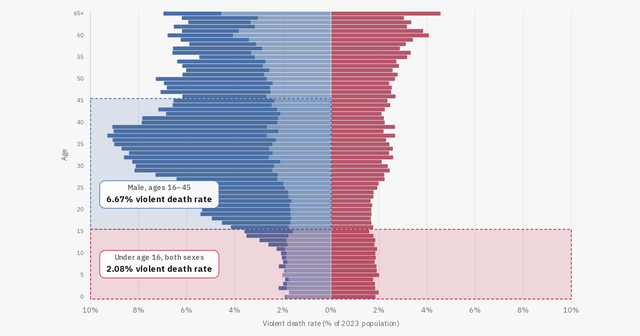

# visualizations

Hub for drc500free's data visualizations, hosted with GitHub Pages at
https://drc500free.github.io/visualizations/

```
index.html                                  hub page (this is what the root URL serves)
violent-death-rate-by-age-and-sex/index.html   the original chart (unchanged)
flame-war/index.html                        "Anatomy of a /r/dataisbeautiful flame war" (interactive)
flame-war/preview.png                       social-sharing image used by both pages
assets/thumb-flame-war.png                  card image on the hub
.nojekyll                                   tells GitHub Pages to serve the files as-is
404.html                                    shown for unknown URLs
```

All links are relative, so the folder works unchanged at the repo root or inside a subfolder.

## Deploying
1. Put these files at the root of the repository (or in a `visualizations/` folder if the repo is `drc500free.github.io`).
2. Settings -> Pages -> Build and deployment -> Source: **Deploy from a branch**, Branch: `main`, folder: `/ (root)`.
3. Wait a minute, then open the URL above.

## Adding a card image for the original chart
Save a 1200x630 screenshot as `assets/thumb-violent-death.png`, then add this line as the first thing inside the first card's `<a class="card" ...>` in `index.html`:

```html

```

## Notes
- The original chart loads Chart.js from cdnjs, so it needs an internet connection to render.
- Moving the original chart into its own folder means the old root URL now shows the hub, which links to the chart in one click.
